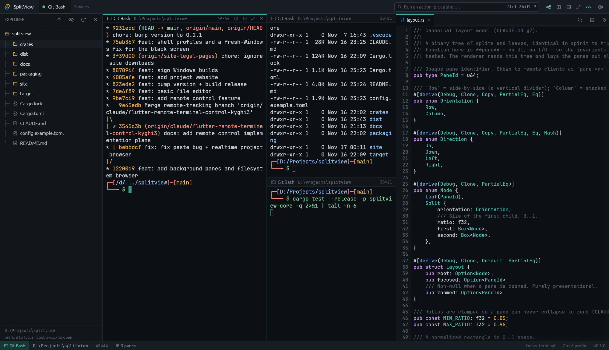

# SplitView

A minimalistic, keyboard-driven terminal emulator: tmux-style split panes as a
native desktop app. Built in **Rust** with **egui** (rendering, layout, UI),
**alacritty_terminal** (terminal emulation) and **portable-pty** (real PTYs).

See **[CLAUDE.md](./CLAUDE.md)** for the architecture, conventions and domain
vocabulary. This README is the quick start.



## Features

- Split panes horizontally (`split_down`) and vertically (`split_right`); move,
  swap, resize and zoom them — all from the keyboard
- A tmux-style **prefix** (default `Ctrl+A`) so terminal keys are never stolen;
  `Ctrl+Shift+P` opens a **command palette** with every action, shell and theme
- Real PTYs, full ANSI/xterm emulation (alacritty_terminal), mouse reporting,
  bracketed paste, selection and copy, `Ctrl+click` on URLs
- **Explorer** sidebar (`<prefix> e`) that follows the focused shell's
  directory, live-updates, and is fully keyboard-driven
- **Editor** panel (`<prefix> E`): tabs, syntax colouring, line numbers, find and
  replace, line wrap (`Alt+Z`), CRLF/BOM-preserving saves that won't overwrite a change made from the
  terminal. `e` on a file in the sidebar, or `splitview edit <file>`
- **Scratchpad** (`<prefix> w`): notes, pen, lines, arrows, rectangles and
  ellipses on a canvas, one pad per project (git root, else folder), autosaved.
  Settings → Panes picks which side panels a new window opens with
- **Claude Code usage** in the status bar while Claude Code runs: context, 5-hour
  and weekly limits (hover for reset times)
- Background panes (`<prefix> b`), new windows (`<prefix> n`), detached panes
  (`<prefix> d`), shell profiles (Git Bash, PowerShell, cmd, zsh… `<prefix> p`)
- **MCP server** (opt-in, off by default): lets an AI agent such as Claude Code
  list, open, close and read panes, run commands in them, and brainstorm on the
  scratchpad. Local only (`127.0.0.1`), behind a token. Settings → MCP shows the
  `claude mcp add …` line to copy
- Small and quiet: one ~10 MB executable, no webview, ~40 MB of memory, and no
  frames drawn while nothing changes

## Layout

```
crates/core/   splitview-core — pure, tested logic: layout tree, keymap/prefix
               engine, config, paths & quoting, OSC scanner, sidebar tree,
               editor model, syntax highlighter, fuzzy matcher
crates/term/   splitview-term — Terminal (alacritty_terminal behind a mutex) and
               its egui widget: renderer, keys, mouse, selection
crates/app/    splitview — the eframe app: hub (PTYs), MCP server, panes,
               chrome, sidebar, editor, scratchpad, dialogs, settings
packaging/     icons, Windows installer (Inno Setup) and signing script
```

## Build and test

Everything is built in release (there is no reason to ship or test a debug build):

```bash
cargo build --release -p splitview      # target/release/splitview(.exe)
cargo test  --release --workspace
cargo clippy --release --workspace --all-targets -- -D warnings
cargo fmt --all
```

### Windows installer

```powershell
powershell -File packaging\windows\build-installer.ps1
# -> dist\SplitView_<version>_x64-setup.exe
```

It needs [Inno Setup 6](https://jrsoftware.org/isinfo.php). The installer is
per-user (no admin rights) and replaces a 0.2.x (Tauri) install in place.

The exe and the installer are Authenticode-signed through
[`packaging/windows/sign-windows.ps1`](./packaging/windows/sign-windows.ps1) when
one of these identities is set:

```powershell
$env:SPLITVIEW_SIGN_THUMBPRINT = "<SHA-1 thumbprint>"        # certificate
# or Azure Artifact Signing:
$env:SPLITVIEW_SIGN_DLIB = "<path to Azure.CodeSigning.Dlib.dll>"
$env:SPLITVIEW_SIGN_METADATA = "<path to metadata.json>"
```

With neither set the build warns and stays unsigned; set
`$env:SPLITVIEW_SIGN_REQUIRED = "1"` to make that an error.

### Screenshots

`splitview --shot out.png --scene main|settings|palette|shell|mcp|background|zoom`
builds a scene, captures the window and exits. Set `SPLITVIEW_CONFIG_DIR` to a
scratch directory so it doesn't touch your settings.

## Configuration

Copy [`config.example.toml`](./config.example.toml) to the config dir
(`%APPDATA%\splitview\config.toml` on Windows, `~/.config/splitview/config.toml`
on Linux) for the prompt style, prefix, shell override, font file and key
bindings. Everything else lives in the Settings window (`<prefix> ,`).
